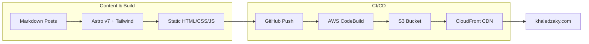
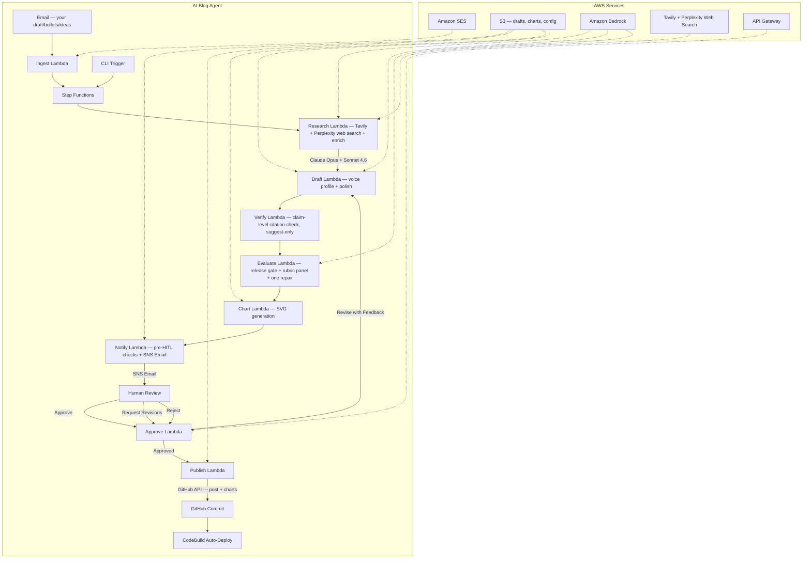
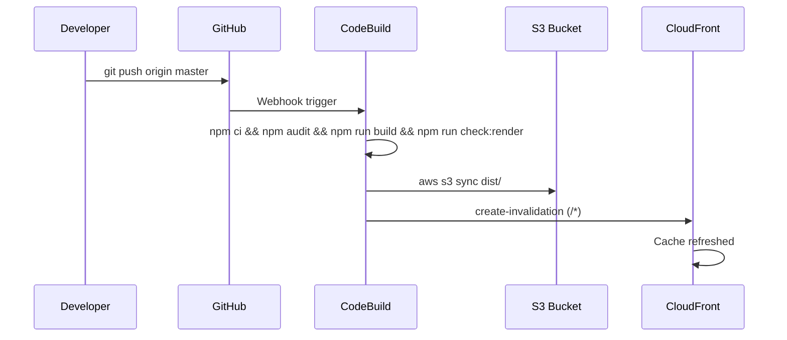
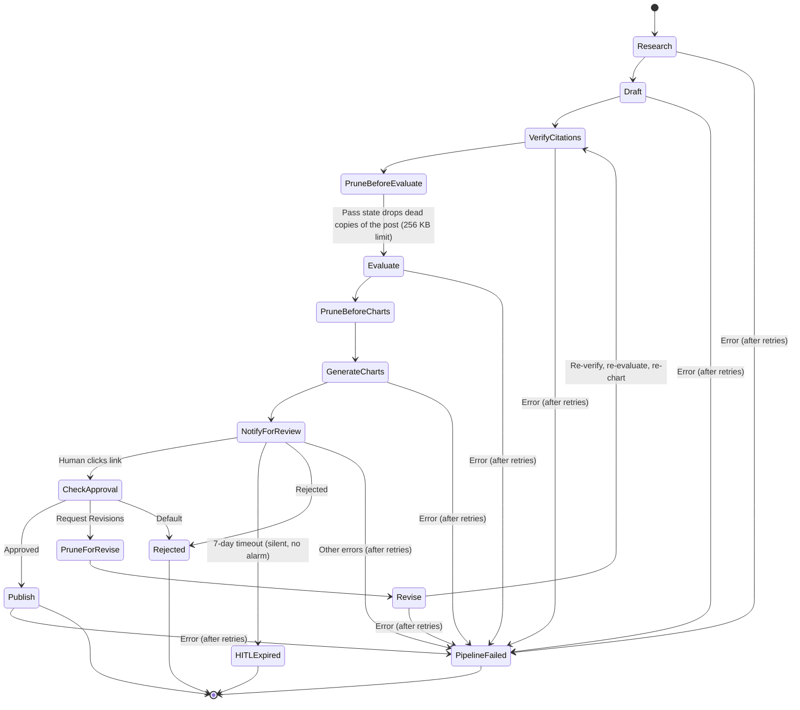
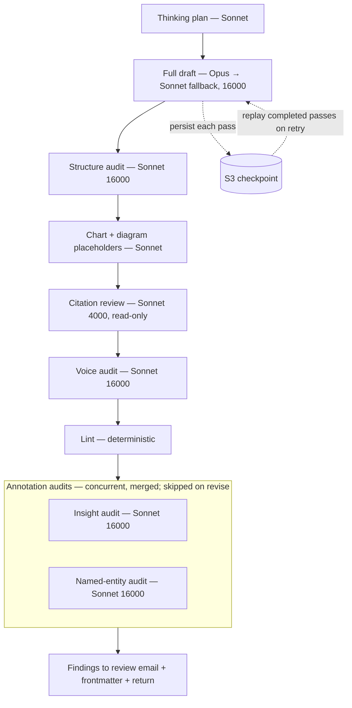

# khaledzaky.com

[](https://github.com/kzaky/khaledzaky.com/actions/workflows/ci.yml)
[]()
[](https://opensource.org/licenses/MIT)
[](https://astro.build)
[](https://tailwindcss.com)
[](https://aws.amazon.com/lambda/)
[](https://aws.amazon.com/bedrock/)
[](https://python.org)
[](https://aws.amazon.com/cloudformation/)

My personal website and blog — [khaledzaky.com](https://khaledzaky.com)

Built with [Astro](https://astro.build) and [Tailwind CSS](https://tailwindcss.com), deployed on AWS, with an AI-powered blog agent that researches, drafts, and publishes posts with human-in-the-loop approval.

---

## Architecture Overview





## Tech Stack

| Layer | Technology |
|-------|-----------|
| **Framework** | Astro v7 with Tailwind CSS v4 (`@tailwindcss/vite` + `@tailwindcss/typography`) |
| **Content** | Markdown with Astro content collections |
| **Build** | AWS CodeBuild (Node.js 22; `package.json` requires Node >=22.12) |
| **Hosting** | Amazon S3 (OAC-locked) + CloudFront (HTTPS-only, compressed, security headers) |
| **TLS** | AWS Certificate Manager |
| **AI Model** | Claude Opus + Sonnet 4.6 + Haiku via Amazon Bedrock (with voice profile) |
| **Web Search** | Tavily API (breadth: all 5-8 queries, 8 results each) + Perplexity sonar-pro (synthesis: first 2 queries, independent index, parallel) |
| **Charts & Diagrams** | SVG bar/donut charts (from numeric data) + conceptual diagrams: comparison, progression, stack, convergence, venn (LLM-detected, code-rendered). All support light/dark mode via CSS custom properties. SVGs are inlined at runtime via client-side JS for dark mode support |
| **Orchestration** | AWS Step Functions |
| **Approval** | API Gateway HTTP API + Lambda |
| **Notifications** | Amazon SNS (email) |
| **Email Ingest** | Amazon SES (inbound) + Route 53 MX |
| **DNS** | Amazon Route 53 |
| **Secrets** | AWS SSM Parameter Store (SecureString) — GitHub token, Tavily API key, Perplexity API key |
| **Source Control** | GitHub (master branch, webhook-triggered deploys) |

## Project Structure

```
khaledzaky.com/
├── src/
│   ├── components/       # Astro components (Header, Footer, SectionCard, CredibilityRow)
│   ├── content/blog/     # Markdown blog posts (content collection)
│   ├── layouts/          # BaseLayout, BlogPost layout
│   ├── pages/            # index, about, work, blog routes (rss.xml.js)
│   ├── plugins/          # Rehype plugins (lazy images)
│   └── styles/           # Global CSS (Tailwind v4 @theme + design tokens)
├── public/               # Static assets (images, favicon)
├── agent/                # AI blog agent (Lambda functions + IaC)
│   ├── research/         # Enriches author's points with data & citations
│   ├── draft/            # Polishes author content (checkpointed multi-pass chain)
│   ├── chart/            # Renders SVG charts + conceptual diagrams (5 types)
│   │   └── renderers/    # Modular renderers: bar, pie, comparison, progression, stack, convergence, venn
│   ├── verify/           # Claim-level citation check (suggests repairs, never edits the post)
│   ├── evaluate/         # Release gate + five-seat rubric panel + one guarded repair
│   ├── notify/           # SNS email with one-click approve/revise/reject
│   ├── approve/          # API Gateway handler for approval + revision feedback
│   ├── publish/          # Commits posts + chart images to GitHub
│   ├── ingest/           # SES email trigger — parses author content & directives
│   ├── alarm-formatter/  # Turns CloudWatch alarms into readable emails
│   ├── upload/           # Authoring helper outside the pipeline
│   ├── common/           # Shared modules vendored into zips at build time (llm.py, gate.py)
│   ├── evals/            # Ground-truth corpus of the author's hand fixes + offline gate runner
│   ├── scripts/          # package-lambda.sh / deploy-lambda.sh (guarded build + deploy)
│   ├── voice-profile.sample.md  # Format of the voice profile (the real one is private, outside the repo)
│   ├── tests/            # Smoke + behavioral tests (handlers, llm, checkpoint, audits)
│   ├── ruff.toml         # Python linter configuration
│   ├── template.yaml     # CloudFormation template
│   └── deploy.sh         # One-command deployment script
├── infra/                # Site infrastructure IaC
│   ├── template.yaml     # CloudFormation — CloudFront, IAM, monitoring, CloudTrail
│   ├── storage.yaml      # CloudFormation — S3 bucket (us-east-2)
│   └── deploy.sh         # Deployment script (requires email, cert ARN, zone ID)
├── .github/workflows/   # GitHub Actions CI (Node build + audit, Python lint + tests)
├── docs/                 # Design notes (EVAL-PLAN.md: quality gates plan and evidence)
├── RECOVERY.md           # Disaster recovery runbook (gitignored; kept privately, not in this repo)
├── buildspec.yml         # AWS CodeBuild build specification
├── astro.config.mjs      # Astro configuration
└── package.json
```

## Running Locally

```bash
# Clone the repo
git clone https://github.com/kzaky/khaledzaky.com.git
cd khaledzaky.com

# Install dependencies
npm install

# Start dev server
npm run dev
# → http://localhost:4321

# Build for production
npm run build
# → outputs to dist/
```

Requirements: Node >=22.12 (the `engines` field in `package.json`), and Python 3.11+
for the agent tests (the Draft handler uses `datetime.UTC`; Lambda and CI run 3.12).

Checks CI runs, and how to run them locally:

```bash
npm run check:render                  # built-HTML shape gate (run after npm run build)
npx playwright install chromium       # one-time: check:svg drives a headless Chromium
npm run check:svg                     # figure overflow at desktop and 375px widths

pip install ruff pytest pyyaml cfn-lint
python3 -m pytest agent/tests/ -q
ruff check agent/ --config agent/ruff.toml
cfn-lint agent/template.yaml
python3 agent/evals/run_gate.py       # 0 gate errors on every published post + corpus scoring
```

## Deployment

Deployment is fully automated. Pushing to `master` triggers AWS CodeBuild, which:

1. Installs dependencies (`npm ci`)
2. Audits dependencies (`npm audit --audit-level=high`, logged but not blocking)
3. Builds the site (`npm run build`)
4. Runs the render-shape gate (`npm run check:render`); if it or any earlier phase failed, the deploy stops and the live site is untouched
5. Syncs `dist/` to the S3 bucket (`--delete` to remove stale files; `_astro/` assets get a one-year immutable cache header, HTML gets an edge TTL)
6. Invalidates the whole CloudFront cache (`/*`), since HTML now carries an edge TTL



## AI Blog Agent

The blog agent is your **editor, not your ghostwriter**. You provide your draft, bullets, or ideas — the agent enriches them with research and data, polishes the prose in your voice, generates data-driven charts and conceptual diagrams, and publishes with your approval.

### How It Works

1. **Trigger** — Send an email to `blog@khaledzaky.com` with your draft/bullets in the body, or run the CLI
2. **Ingest** (email only) — SES receives the email; Ingest Lambda parses author content and optional directives (Categories, Tone, Goal, Avoid, Analogies). A `Hero:` line is parsed and passed along, but nothing generates a hero image yet
3. **Research** — Generates 5-8 targeted search queries via Claude Haiku, then reshapes the first 2 for Perplexity (natural-language questions via Haiku) while Tavily searches are already in flight. Runs two parallel searches: Tavily (all queries, 8 results each — breadth) and Perplexity sonar-pro (first 2 reshaped queries — independent synthesis + citation URLs). After search results are assembled, editorial hooks extraction (Sonnet — surfaces contradictions, surprises, expert tensions) and the thinking plan (Sonnet `invoke_model+thinking` — research angles + post structure) run in parallel and are injected into the synthesis prompt. Synthesis runs on Claude Opus (falls back to Sonnet 4.6), enriching the author's points with supporting data and verified inline citations (`[text](url)` format). A cross-reference fact-check pass (Sonnet) verifies key claims against sources before they reach the draft
4. **Draft** — Claude Sonnet 4.6 (with extended thinking) plans the post from the private voice profile, then a full generation pass on Claude Opus (falls back to Sonnet 4.6) writes the complete draft at a 16000-token budget. The passes after it run in this order: structure audit (TL;DR, headings; runs before placeholders exist), chart and diagram placeholder insertion, a **read-only** citation review (4000 tokens; reports findings, never edits the post), voice audit (full rewrite), a deterministic lint (`_lint_slop`: dashes and prose findings), then the insight and named-entity audits, which **run concurrently and are merged**. The structure, voice, insight and entity passes run at 16000 tokens, and every rewrite goes through `gate.guard_rewrite`. Anything those passes would have written into the post as a comment is lifted out and sent to the review email as a finding. The annotation audits are skipped in revision mode, and a finished article sent as the author content is preserved as written (only the placeholders and the read-only review run). The only Haiku passes are category inference and, when needed, the meta description. **Resume-on-retry checkpointing** persists each pass to S3 so a Step Functions retry replays completed passes instead of re-running the expensive Opus generation. Accepts Goal/Avoid/Analogies directives from the ingest step
5. **Verify** — Claim-level source check (L1), **suggest-only by default**. Every external link is fetched (96KB), up to 12K characters of page text and the publish date are extracted, and one Haiku call per link returns a structured verdict with the supporting quote. A sentence that states a figure, ratio, multiple, "doubles" or "proven" passes only if the quote really occurs in the page and the figure appears there. For a failing link, Tavily looks for a better source and the candidate is reported as a suggestion. Verify writes nothing into the post: verdicts, suggested URLs, unsupported precision claims and the freshest source's age go to the review email. `VERIFY_AUTO_REPAIR=1` restores the old in-place URL swap (marked `<!-- 🔁 CITATION REPLACED: old -> new -->`)
6. **Evaluate** — Rubric panel (L2) with a bounded repair loop. The deterministic release gate runs first; then five atomic seats run concurrently and return findings anchored to quoted text: fact checker, target reader (a platform/security engineer at a regulated enterprise), skeptical expert, voice fidelity (against three of my own pre-agent posts), and author intent on the full text. The taste seats run on a different model family than the drafter (`JUDGE_MODEL_ID`, via Bedrock Converse; the live list is the `/blog-agent/models/judge` SSM parameter) so the writer never grades its own voice. Blocking findings get one minimal-edit repair pass, accepted only if the post's shape is intact; anything still blocking reaches me as findings on the review email
7. **Chart & Diagram** — Handles two types of visuals: (1) matches structured data points to `<!-- CHART: -->` placeholders and renders SVG bar/donut charts, (2) parses `<!-- DIAGRAM: -->` placeholders and renders conceptual SVG diagrams (comparison, progression, stack, convergence, venn). All visuals use the site's color palette with light/dark mode support (CSS custom properties + `.dark` class)
8. **Notify** — Five pre-HITL checks run before anything reaches your inbox: (1) no unexpected annotation comments, (2) no duplicate image paths, (3) no unreplaced placeholder text, (4) every chart image ref in the markdown has a matching generated SVG, and (5) the deterministic release gate (exactly one frontmatter block, none nested, body not wrapped in a code fence, no LLM preamble, enough sections). Hard failure on any check routes to `PipelineFailed`, so broken drafts never reach review. On pass, the draft is saved to S3 and a full-text email is sent with the citation block, the draft's review findings, pipeline warnings (gate prose findings, chart findings), the rubric-panel scorecard, a Haiku intent check, a presigned download link and three one-click actions
9. **Review** — The pipeline pauses and waits for human action (up to 7 days):
   - **Approve** — publishes the post and charts immediately
   - **Request Revisions** — opens a feedback form; the agent revises and re-sends
   - **Reject** — discards the draft
10. **Publish** — On approval, every review-only annotation is stripped (emoji-optional and multi-line safe — three shapes used to leak to the live site), then the clean post and chart/diagram SVGs are committed to GitHub via API, triggering auto-deploy. GitHub API retries up to 4 times with exponential backoff on transient errors. Safety net: catches any unclosed `<!--` after frontmatter to prevent the post body being swallowed. CodeBuild then runs `npm run check:render` on the built pages (one `<h1>`, section headings, no body rendered as `<pre>`, no leaked comments) and refuses to deploy a malformed post

### Deploying the Agent

Prerequisites:
- AWS CLI configured with appropriate credentials
- GitHub Personal Access Token stored in SSM:
  ```bash
  aws ssm put-parameter --name "/blog-agent/github-token" \
    --type SecureString --value "ghp_YOUR_TOKEN"
  ```
- Amazon Bedrock model access enabled for Anthropic Claude

Deploy:
```bash
cd agent
./deploy.sh your-email@example.com
```

Confirm the SNS email subscription when you receive it.

### Triggering a New Post

**Option 1: Email** (preferred)

Send an email from your authorized address to `blog@khaledzaky.com`:
- **Subject** = your blog topic or title idea
- **Body** = your draft, bullets, ideas, or stream of consciousness
- Optional directives: `Categories: tech, cloud`, `Tone: more technical`, `Goal: reader takeaway`, `Avoid: vendor comparisons`, `Analogies: distributed tracing` (`Hero: yes` is parsed but not implemented: no hero image is generated)

The agent uses your content as the skeleton and polishes it in your voice.

**Option 2: CLI**

```bash
aws stepfunctions start-execution \
  --state-machine-arn $(aws cloudformation describe-stacks \
    --stack-name blog-agent \
    --query 'Stacks[0].Outputs[?OutputKey==`StateMachineArn`].OutputValue' \
    --output text) \
  --input '{"topic": "Your topic here", "categories": ["tech", "cloud"], "author_content": "Your bullets and ideas..."}'
```

### Agent Architecture



The **Draft** step is the heaviest Task — one Opus generation pass followed by a chain of
Sonnet passes. It checkpoints each pass to S3 (so a retry replays completed work
instead of re-running Opus) and runs the two independent annotation audits concurrently:



### Why Step Functions Instead of LangChain/LangGraph

The blog agent uses AWS Step Functions with single-purpose Lambda functions instead of an agentic framework like LangChain or LangGraph. This is a deliberate choice:

- **Deterministic workflow** — The pipeline is a known sequence (Research → Draft → Verify → Evaluate → Chart → Review → Publish), not a dynamic reasoning loop. Step Functions is purpose-built for this.
- **Debuggability** — Every step is visible in the Step Functions console with full input/output. Agent framework loops are significantly harder to trace and debug.
- **Cost predictability** — Fixed number of LLM calls per run. No risk of runaway tool-use loops.
- **Native HITL** — `waitForTaskToken` handles human-in-the-loop approval without needing a persistence backend (Postgres, Redis) or custom resume logic.
- **Durable retries** — Each Task retries with backoff and catches to `PipelineFailed`. The Draft Lambda goes further with S3 checkpointing, so a retry of its long multi-pass chain replays completed passes instead of re-paying for the expensive Opus generation — durable execution without a workflow engine like Temporal.
- **Operational maturity** — Retries with exponential backoff, catch blocks, DLQ, X-Ray tracing, CloudWatch alarms, and per-function IAM least privilege come from the infrastructure, not framework abstractions.
- **No framework dependency** — Plain Python + Bedrock SDK. No version churn, no breaking API changes, no transitive dependency surface.

The tradeoff: the agent can't dynamically decide to call tools or branch its own reasoning. If the Draft step finds a research gap, it can't autonomously loop back. That's acceptable here — the workflow is well-defined, and the "basic" is a feature, not a limitation.

### Security

- **Secrets** — GitHub token, Tavily API key, and Perplexity API key stored in SSM Parameter Store as SecureString, never in code or environment variables
- **IAM** — Each Lambda function has its own IAM role scoped to only the permissions it needs (e.g., Approve can only send task tokens, Ingest can only read inbound email and start executions, Publish can only read drafts and access the GitHub token)
- **API Gateway** — Approval endpoint is public but uses one-time Step Functions task tokens that expire after 7 days
- **S3** — AES-256 server-side encryption enabled; all public access blocked (4/4 settings); Origin Access Control (OAC) restricts reads to CloudFront only; S3 website hosting disabled
- **SES** — TLS required on inbound email; spam and virus scanning enabled; only authorized sender processed
- **Encryption** — SSM parameters use AWS-managed KMS
- **No hardcoded credentials** — All sensitive values injected via environment variables or SSM at runtime
- **Lifecycle** — Draft objects auto-expire after 90 days

### Cost Estimate

Measured from Bedrock's CloudWatch token metrics (October 2026), at list prices:

| Run | Bedrock cost |
|-----|--------------|
| Single-pass post (no revision) | ~$1.32 |
| Typical post with one revise | ~$2.26 |

Bedrock is almost all of it. The LLM calls per run: query generation, Perplexity reshape,
editorial hooks, research thinking plan, research synthesis (Opus), cross-reference
fact-check and chart data extraction in Research; thinking plan, full draft (Opus),
structure, placeholders, citation review, voice, insight and named-entity passes in Draft;
one Haiku call per cited link in Verify; five rubric seats plus at most one repair in
Evaluate; and the intent check in Notify. A revise re-runs Draft (without the annotation
audits), Verify and Evaluate. A Step Functions retry replays completed Draft passes from the
S3 checkpoint, so it costs only the unfinished passes.

| Other resource | Cost |
|----------------|------|
| Lambda (11 functions), Step Functions, S3, SNS, API Gateway, SES | ~$0.00 per post (free tier or fractions of a cent) |
| Tavily web search (5-8 queries/run, free tier: 1,000/month) | ~$0.00 |
| Perplexity sonar-pro (2 synthesis queries/run at $3/1,000 searches) | ~$0.01 |

## Infrastructure Hardening

The hosting infrastructure has been hardened across security, performance, and cost:

| Area | Detail |
|------|--------|
| **S3 Access** | Public access fully blocked; Origin Access Control (OAC) restricts reads to CloudFront distribution ARN only |
| **HTTPS** | HTTP requests 301-redirect to HTTPS; TLS 1.2 minimum enforced |
| **Security Headers** | CSP, HSTS (preload), X-Frame-Options, X-Content-Type-Options, Referrer-Policy, X-XSS-Protection, Permissions-Policy, X-Robots-Tag via CloudFront response headers policy |
| **Compression** | Gzip + Brotli enabled on CloudFront |
| **URL Rewriting** | CloudFront Function handles `index.html` resolution (replaces S3 website hosting) |
| **Custom Errors** | 403 and 404 mapped to `/404.html` |
| **TLS Certificate** | Wildcard ACM cert (`*.khaledzaky.com` + apex), auto-renewing |
| **Price Class** | PriceClass_100 (NA + EU edge locations) |
| **HTTP/2 + HTTP/3** | Both enabled on CloudFront |

## Infrastructure as Code

All infrastructure is managed via CloudFormation across three stacks:

| Stack | Region | Resources |
|-------|--------|-----------|
| **`khaledzaky-infra`** | us-east-1 | CloudFront distribution, OAC, security headers policy, index rewrite function, IAM role, Route 53 health check, CloudWatch alarm + dashboard, CloudTrail |
| **`khaledzaky-storage`** | us-east-2 | S3 site bucket (versioning, AES-256 + BucketKey, 90-day lifecycle) |
| **`blog-agent`** | us-east-1 | 11 Lambda functions (research, draft, verify, evaluate, chart, notify, approve, publish, ingest, upload, alarm-formatter), Step Functions (with retry/catch, three payload-pruning Pass states and an `HITLExpired` silent timeout state), SNS, S3 drafts bucket (90-day lifecycle + 7-day `checkpoints/` rule), SQS DLQ, API Gateway (throttled: 5 req/s, burst 10), 15 CloudWatch alarms (listed under Monitoring). Draft Lambda checkpoints multi-pass state to S3 for resume-on-retry |

Resources not in CFN (import not supported): CodeBuild project, AWS Budget, S3 bucket policy, Lambda/CodeBuild log group retention (managed via CLI).

## Monitoring & Observability

| Area | Detail |
|------|--------|
| **Uptime** | Route 53 HTTPS health check (30s interval) → CloudWatch alarm → SNS email if site goes down |
| **Dashboard** | CloudWatch dashboard (9 sections): CloudFront traffic + origin latency + error rates, Route 53 health check + alarm status grid, CodeBuild deploy frequency + duration, Lambda invocations/errors/duration/throttles, Step Functions pipeline pass/fail, API Gateway, SNS delivery, Bedrock token usage (Opus 4.6 + Sonnet 4.6 + Haiku 4.5), billing vs budget + S3 size |
| **Alerting** | 15 CloudWatch alarms in the `blog-agent` stack: `pipeline-failure` (real error/cause via `ErrorPath`/`CausePath`; HITL 7-day timeouts silently route to `HITLExpired`, no alarm); one `errors-<fn>` alarm per Lambda (research, draft, verify, evaluate, notify, publish, approve, ingest, chart, upload, alarm-formatter), which carry no action themselves; the `lambda-errors-any` composite alarm that ORs those 11 and holds the notification; `api-5xx`; and `opus-model-fallback` (Opus fell back to Sonnet). All notify via the alarm-formatter Lambda. The site stack adds `khaledzaky-site-down` |
| **Logging** | Structured JSON logging (with correlation IDs) on all 11 Lambda functions; 30-day retention on Lambda + CodeBuild log groups, 90-day on Step Functions |
| **Dead Letter Queue** | SQS DLQ on Ingest Lambda catches failed async invocations from SES |
| **Error Handling** | Step Functions Retry (with exponential backoff) on all Task states; Catch → PipelineFailed for unrecoverable errors |
| **Audit** | CloudTrail multi-region trail → S3 (management events) |
| **Tracing** | X-Ray active on all 11 Lambda functions + Step Functions |
| **Annotation Cleanup** | Draft lifts its review comments out of the post into the review email, and Publish still strips any review-only comment (`CITATION FAIL/NOTE/REPLACED`, `INSIGHT`, `ENTITY CHECK`, `STRUCTURE`) as a backstop before committing to GitHub. Safety net catches any unclosed `<!--` after frontmatter |
| **Budget** | $35/month with 80% and 100% email alerts |
| **SEO** | Google Search Console verified, sitemap + RSS autodiscovery, JSON-LD schema |

## License & Copyright

Copyright Khaled Zaky. All rights reserved for the following — you may not reuse without written permission:
- `src/content/blog/` (blog post content)
- `public/img/` (personal images)

The code and styles are licensed under the MIT License (a LICENSE file is not yet committed).
