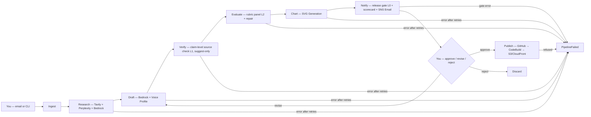
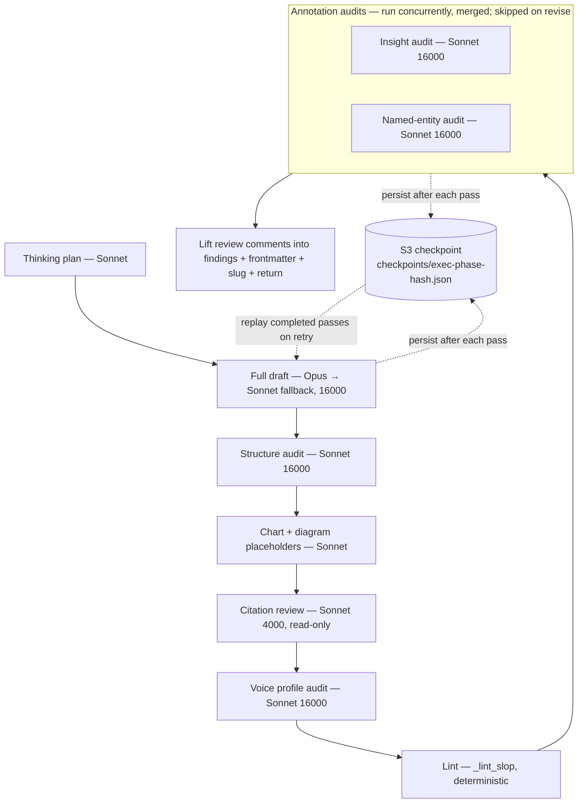

# Blog Agent — AI-Assisted Blog Writing Pipeline

An AWS-native blog writing agent that takes your draft, bullets, or ideas — enriches them with research and data — and produces a polished blog post in your voice. Human-in-the-loop (HITL) approval at every step.

## Philosophy

The agent is your **editor, not your ghostwriter**. You provide the ideas, opinions, and framing. The agent:
1. Enriches your points with supporting data, statistics, and citations
2. Polishes prose and structures the post using your voice profile
3. Generates data-driven SVG charts and conceptual diagrams (comparisons, staircase models, layered stacks, convergence patterns, Venn diagrams) from the draft content
4. Publishes to your site after your explicit approval

## Architecture



### Stage artifacts: large outputs stay out of Step Functions state

Step Functions caps execution state at 256 KB, and an oversized result fails the
execution with `States.DataLimitExceeded`, which skips Catch (runs ab924859 and 4e0f28a4
died that way; 19fc39e3 reached 243 KB). So stages do not pass the post through state.
Each stage (`common/artifacts.py`, vendored via `.common-deps`) writes its large fields
to `s3://<drafts>/runs/<execution name>/<stage>-<sha256[:16]>.json` and returns only the
small fields the state machine reads plus `{key, sha256, summary}`; the next stage gets
a `*_ref` and loads what it needs, checking the hash. Keys are content-addressed, so a
retry, revise or redrive never makes an old ref point at new bytes.

| Stage | Goes to the artifact | Stays in state |
|---|---|---|
| Research | research notes, author content | topic, directives, suggested title/description |
| Draft / Revise | markdown, validation report | title, slug, categories, description, date |
| Verify | markdown, verification (details, citation notes) | metadata, `verification_summary` counts |
| Evaluate | markdown, evaluation | metadata, `evaluation_summary` |
| Chart | markdown | metadata, charts list, `markdown_sha256`, `review_key` |

The execution name reaches every Task as `run_id` (`$$.Execution.Name`); Research wraps
the execution input as `{"input": ..., "run_id": ...}` and its ResultSelector drops the
input's own copy of the author content. In the chained test
(`tests/test_pipeline_artifacts.py`, three revisions) the largest state is about 7.5 KB;
the previous definition peaks at about 143 KB on the same fixture. No Prune states are
needed any more. `runs/` expires after 60 days.

A handler without `run_id` in its event (an execution started on the previous
definition, which Step Functions keeps running on that definition) hydrates nothing and
returns the old inline shape, so in-flight runs survive a code deploy.

### Quality gates — three layers, three substrates

The pipeline used to have checks but no gates: eight LLM passes and four
deterministic checks ran on every draft, yet only a missing chart file could stop
a post, and five of five agent-published posts needed hand fixes afterwards. The
gates now follow the substrate ladder the blog argues for: deterministic for
anything expressible deterministically, a model only for the semantic residue,
and the drafter's own family never grading its own voice.

| Layer | Where | Substrate | Blocks? | Catches |
|---|---|---|---|---|
| **L0 release gate** | `common/gate.py`, run by Draft (lint), Notify (pre-HITL), Evaluate, the eval harness and `scripts/check-render-shape.mjs` on the built site | regex / parser | errors yes; prose findings advisory | fenced body, nested frontmatter, LLM preamble, missing sections, leaked annotations, unrendered placeholders; forbidden phrases, antithesis and italic closers, rule-of-three fragments, stacked contrasts, `-ise` spelling |
| **L1 claim verification** | `verify/` | Haiku per link on up to 12K chars of the page | no; suggest-only by default (`VERIFY_AUTO_REPAIR=0`): writes nothing into the post, and its verdicts, suggested URLs and unsupported precision claims go to the review email | wrong-but-resolving ids, figures the source never states, source recency; URL swaps happen only with `VERIFY_AUTO_REPAIR=1` (marked `CITATION REPLACED`) |
| **L2 rubric panel** | `evaluate/` | five atomic seats, structured findings; taste seats on `JUDGE_MODEL_ID` (cross-family via Converse) | fact-check blocking findings and low author-intent block; reader / expert / voice are advisory | overclaiming, vendor framing, drifted author intent, un-authorlike prose |
| **Repair** | `evaluate/` | one Sonnet pass fed only blocking findings, accepted only if `gate.guard_rewrite` finds the shape intact | at most `EVAL_MAX_REPAIRS` (1) | — |
| **Edge** | CI + CodeBuild `npm run check:render` | HTML shape of every built page | fails the deploy | a body rendered as `<pre>`, duplicate `<h1>`, leaked review comments |

The two full-rewrite passes in Draft (voice and structure) run
through the same `gate.guard_rewrite` invariants — placeholders kept, word count within
bounds, headings unchanged (structure may add two), citations not lost — and a rejected
rewrite keeps the original and sends a structure note to the review email. The citation
pass is read-only and never rewrites.
Ground truth for all of this is `evals/` (see `evals/README.md`): 29 hand fixes the
author made after publication (20 with a signal the deterministic gate can see, all
passing; 9 that need an LLM seat), plus a zero-error oracle over all 55 published
posts, scored by `evals/run_gate.py` and in CI.

### Draft Lambda — internal multi-pass pipeline

The Draft step is the heaviest in the pipeline. It runs one expensive Opus generation
pass followed by a chain of Sonnet insertion/audit passes. Two properties make it
resilient and fast:

- **Resume-on-retry checkpointing** — the output of every pass is persisted to S3 under
  a key that is stable across Step Functions retries of the Task. A transient failure in
  a late audit replays the completed passes from S3 instead of re-invoking the (most
  expensive) Opus generation.
- **Parallel annotation audits** — the insight and named-entity audits are annotation-only
  (they insert review comments, never rewrite prose) and independent, so they run
  concurrently and their comments are merged. This removes a full ~90–130s Sonnet pass
  from the wall-clock.



The structure audit runs before the placeholders so no `CHART`/`DIAGRAM` comment is in
the draft yet. When the author content is already a finished article, the prose passes
(generation, structure, voice, annotations) are skipped and the submission is kept as
written.

### Components (11 Lambda functions)
- **Ingest Lambda** — Receives inbound email via SES, parses author content and directives (Categories, Tone, Goal, Avoid, Analogies), starts the pipeline. A `Hero:` directive is parsed and passed through as `generate_hero`, but nothing generates a hero image: not implemented. SQS dead letter queue catches failed async invocations
- **Research Lambda** — Generates 5-8 targeted search queries via Claude Haiku, then runs two parallel searches simultaneously: Tavily (all queries, 8 results each — breadth) and Perplexity sonar-pro (first 2 reshaped queries — independent synthesis + citation URLs). Perplexity queries are reformulated from keyword form to natural-language questions by a Haiku pass (`build_perplexity_queries`) that overlaps with the Tavily search executor. After search results are assembled, two Sonnet passes run in parallel: `_extract_editorial_hooks` (Sonnet — surfaces contradictions, surprises, and expert tensions from Perplexity synthesis + Tavily snippets) and `_thinking_plan` (Sonnet `invoke_model+thinking` — frames research angles and post structure). Both outputs are injected into the main synthesis prompt. Research synthesis (Opus — `SYNTHESIS_MODEL_ID`, falls back to Sonnet 4.6 on access/throttle errors) produces enriched notes with verified inline citations. A cross-reference fact-check pass (Sonnet) verifies key claims against sources. URL verification drops broken sources before they reach the draft. Graceful degradation if either search engine is unavailable. Cold-start smoke test validates the thinking API contract on every new container
- **Draft Lambda** — Two-pass generation followed by a checkpointed chain. (1) A short thinking pass via `llm.invoke_with_thinking` (adaptive thinking first, `enabled`+`budget_tokens` fallback for models that still need it — the 5-generation models reject `budget_tokens`) produces a drafting/revision plan. (2) A full generation pass (Claude Opus — `DRAFT_MODEL_ID`, falls back to Sonnet 4.6 on access/throttle errors, 16000 tokens) produces the complete post. Then, in order, all on Sonnet: the structure audit (16000; runs before placeholders exist, never adds a closing line — 17 of the author's 18 pre-agent posts end in plain prose), chart and diagram placeholder insertion (restored verbatim from the previous draft on a revise), the citation review (4000; **read-only**, a findings report that never edits the body), the voice profile audit (16000; full rewrite), `_lint_slop` (deterministic: hard-fixes em/en dashes and reports the shared gate's prose findings), and the insight and named-entity audits (16000 each, **run concurrently and merged**, skipped in revision mode). The voice and structure rewrites are shape-guarded by `gate.guard_rewrite`. Review comments the passes leave in the body are lifted out into review findings for the email, so the returned post carries none. When the author content is already a finished article, generation and the prose rewrites are skipped and the submission is kept as written. Haiku is used only for category inference (`_infer_categories`) and a missing meta description. **Resume-on-retry checkpointing** persists each pass's output to S3, so a Step Functions retry replays completed passes instead of re-running the expensive Opus generation (disable with `DRAFT_CHECKPOINTS=0`; parallel audits with `DRAFT_PARALLEL_AUDITS=0`). Three modes: author-content polishing, revision from feedback, topic-only fallback
- **Verify Lambda** — Claim-level citation verification (L1), **suggest-only by default** (`VERIFY_AUTO_REPAIR=0`). Fetches every external URL (96KB), extracts up to 12K chars of page text and the publish date, then runs one Haiku call per link that returns a structured verdict with the supporting quote. The claim is the sentence containing the link; a sentence stating a figure, ratio, multiple, "doubles" or "proven" passes only if the quote really occurs in the page and the figure appears there. A page that loads without readable text is UNREACHABLE, not FAIL. For each FAIL/WARN, Tavily searches for a better source and Haiku picks a candidate, reported as `suggested_url`; primary sources and author-supplied URLs are never replaced. Verify writes nothing into the post: the verdicts and suggestions go to the citation block of the review email. `VERIFY_AUTO_REPAIR=1` restores the old in-place swap (marked `<!-- 🔁 CITATION REPLACED: old -> new -->`). Summary adds `precision_unsupported`, `dated_sources`, `min_source_age_days`. `VERIFY_PER_LINK=0` restores the batched Sonnet call
- **Evaluate Lambda** — Rubric panel (L2) with a bounded repair loop. Runs the L0 gate, then five atomic seats concurrently (`fact_checker`, `target_reader`, `skeptical_expert`, `voice_fidelity` against three of the author's pre-agent posts from `config/voice-references/`, `author_intent` on the full author content vs the full draft). Taste seats run through the Converse API on the first accessible model in `JUDGE_MODEL_ID`, a comma-separated priority list whose live value is the `/blog-agent/models/judge` SSM parameter (written by `scripts/update-judge-model.sh`, read by `deploy.sh`); the seats fall back to Sonnet once every candidate is unavailable, and `JUDGE_MODEL_ID_<SEAT>` overrides one seat. Gate errors, blocking fact-check findings and an intent score below `INTENT_BLOCK_BELOW` block; one guarded repair pass then re-runs the blocking seats; whatever remains reaches the reviewer as findings
- **Chart Lambda** — Handles two types of visuals: (1) matches structured data points from research to `<!-- CHART: -->` placeholders and renders SVG bar/donut charts, (2) parses `<!-- DIAGRAM: -->` placeholders and renders conceptual SVG diagrams (comparison, progression, stack, convergence, venn). All visuals use the site's color palette with light/dark mode support (CSS custom properties + `.dark` class). Saves to S3. Self-heals after revision loops: when 0 placeholders are found but the markdown already contains `/postimages/charts/` image refs (placeholders were replaced in a prior run before the revision), scans the markdown and reconstructs the charts list so Publish can still commit the SVGs
- **Notify Lambda** — Runs the pre-HITL validation before sending the email: (1) unexpected HTML annotation comments, (2) duplicate image paths, (3) placeholder text that should have been replaced, (4) chart image refs with no charts-list entry, (5) the shared L0 release gate (exactly one frontmatter block, none nested, body not fenced, LLM preamble, section count). Any error routes to `PipelineFailed`; the gate's advisory prose findings are listed under PIPELINE WARNINGS. Stores draft in S3, then sends the full-text SNS email with the citation block (links checked, passed, warnings, failures, unreachable, per-link notes and suggested replacements, precision claims unsupported, freshest source age), the draft's review findings, chart findings, the rubric-panel scorecard, the intent check, and one-click approve/revise/reject links
- **Approve Lambda** — API Gateway handler that processes approval, revision feedback, or rejection
- **Publish Lambda** — On approval, loads the reviewed draft from the `review_key` Notify stored it at (`runs/<execution>/review-<sha256>.md`) and refuses (`ReviewedDraftMismatch`) unless its sha256 equals the `markdown_sha256` the Chart stage recorded, so what goes live is what the reviewer saw. Strips every review-only annotation through `_strip_review_annotations` (emoji optional, multi-line safe: the three shapes that previously leaked to the live site), then commits the clean post and chart images to GitHub in one commit (triggers CodeBuild deploy) with an `Execution: <name>` trailer. **Safe to retry:** if the post at HEAD already has the blob this run would write, it returns success without a second commit; a ref update that loses a race (422) is rebuilt on the new HEAD, up to 3 times. Refuses to replace an existing post unless the run is marked `revision_of` it, and a failed chart upload aborts the commit. GitHub calls time out after 10 s and are retried up to 4 times on 502/503/504 and network errors; the Lambda has 120 s. Safety net: catches any unclosed leading `<!--` after frontmatter to prevent the post body being swallowed
- **Upload Lambda** — An authoring helper outside the pipeline; not part of the Step Functions flow
- **Alarm Formatter Lambda** — Turns CloudWatch alarm notifications into readable emails with context

### Supporting Services
- **Step Functions** — Orchestrates the pipeline: Research → Draft → Verify → Evaluate → Chart → HITL Review → Publish, with a revision loop (CheckApproval → Revise → Verify). State carries artifact refs, not the post (see Stage artifacts above). All Task states have Retry (exponential backoff on Lambda transient errors). Every Task but Publish catches into PipelineFailed; Publish catches only refusals (`PublishRefused`, `ReviewedDraftMismatch`, `ValueError`) and retries timeouts (`States.Timeout`, `Sandbox.Timedout`) and GitHub errors, so a Publish that still fails stops the execution at Publish, where it can be redriven. The execution name is threaded into every Task (`run_id`, and `execution_id` for the Draft checkpoints)
- **API Gateway** — HTTP API for one-click approval actions from email
- **SNS** — Email notifications for draft review
- **SES** — Inbound email processing (receives emails to `blog@khaledzaky.com`)
- **S3** — Draft and chart storage, stage artifacts under `runs/` (expire after 60 days), plus the agent's private configuration (auto-expires drafts after 90 days; `config/` never expires)
- **SSM Parameter Store** — Secure storage for GitHub token, Tavily API key, and Perplexity API key
- **Tavily** — Web search API for real-time source discovery (free tier: 1,000 searches/month; runs all 5-8 queries for breadth)
- **Perplexity** — sonar-pro API for independent synthesis and citation discovery (runs first 2 queries in parallel with Tavily; graceful degradation if key absent)

### Voice Profile
The Draft prompts are given a private voice profile kept outside the repo; see
[`voice-profile.sample.md`](voice-profile.sample.md) for the format. The profile was
extracted from analysis of 20+ existing blog posts and captures:
- Tone, sentence structure, opening/closing patterns
- Vocabulary preferences and anti-patterns
- Technical depth expectations
- What the author always/never does in writing

## Cost Estimate

Measured from Bedrock's CloudWatch token metrics (October 2026), at list prices:

- **Single-pass post (no revision):** about **$1.32** of Bedrock
- **Typical post with one revise:** about **$2.26** of Bedrock (a revise re-runs Draft without the annotation audits, then Verify and Evaluate)

The LLM calls per run: Research (query generation, Perplexity reshape, editorial hooks, thinking plan, synthesis on Opus, cross-reference fact-check, chart data extraction), Draft (thinking plan, full draft on Opus, structure, chart and diagram placeholders, citation review, voice, insight and named-entity audits, category inference), Verify (one Haiku call per cited link), Evaluate (five rubric seats plus at most one Sonnet repair) and Notify (the Haiku intent check). On a Step Functions retry, completed Draft passes replay from the S3 checkpoint, so a retry costs only the passes that hadn't finished.

Everything else is close to free per post:
- **Tavily web search:** ~$0.00 (free tier: 1,000 searches/month; 5-8 queries/run at 8 results each)
- **Perplexity sonar-pro:** ~$0.01/run (~2 queries at $3/1,000)
- **Lambda (11 functions), Step Functions, SNS, API Gateway, SES, S3:** ~$0.00 (free tier or fractions of a cent)

## Prerequisites

1. **AWS CLI** configured with credentials
2. **Amazon Bedrock** model access enabled for Claude in your region (us-east-1)
3. **GitHub Personal Access Token** with `repo` scope

## Setup

### 1. Store GitHub token in SSM
```bash
aws ssm put-parameter \
  --name "/blog-agent/github-token" \
  --type SecureString \
  --value "ghp_YOUR_TOKEN_HERE" \
  --region us-east-1
```

### 2. Store Tavily API key in SSM
```bash
aws ssm put-parameter \
  --name "/blog-agent/tavily-api-key" \
  --type SecureString \
  --value "tvly-YOUR_KEY_HERE" \
  --region us-east-1
```
Sign up at [app.tavily.com](https://app.tavily.com) for a free API key (1,000 searches/month).

### 3. Store Perplexity API key in SSM
```bash
aws ssm put-parameter \
  --name "/blog-agent/perplexity-api-key" \
  --type SecureString \
  --value "pplx-YOUR_KEY_HERE" \
  --region us-east-1
```
Get your key at [perplexity.ai/settings/api](https://www.perplexity.ai/settings/api). Optional — agent degrades gracefully to Tavily-only if absent.

### 4. Enable Bedrock model access
- Go to AWS Console → Amazon Bedrock → Model access
- Request access to `Anthropic Claude Sonnet 4.6`

### 5. Deploy the stack
```bash
cd agent
chmod +x deploy.sh
./deploy.sh your-email@example.com
```

This will:
- Deploy the CloudFormation stack (11 Lambdas, Step Functions, S3, SNS, API Gateway, alarms)
- Upload Lambda code from each function directory
- Upload the private voice profile and the voice-reference posts, if present locally

### 6. Confirm SNS subscription
Check your email and click the confirmation link.

## Usage

### Trigger via email (preferred)
Send an email to `blog@khaledzaky.com`:
- **Subject** = your blog topic or title idea
- **Body** = your draft, bullets, ideas, or stream of consciousness

The agent uses your content as the skeleton and polishes it in your voice.

#### Optional directives (add anywhere in the body)
```
Categories: tech, cloud, leadership
Tone: more technical
Goal: what the reader should walk away understanding
Avoid: vendor comparisons, hype language
Analogies: distributed tracing, microservices
```

`Hero: yes` is also parsed, but it is not implemented: no hero image is generated.

### Trigger via CLI
```bash
aws stepfunctions start-execution \
  --state-machine-arn <STATE_MACHINE_ARN> \
  --input '{"topic": "Zero Trust Architecture in AWS", "categories": ["cloud", "aws", "security"], "author_content": "My bullets and ideas here..."}'
```

### Review the draft
You'll receive an email with:
- The full draft text (with charts embedded)
- Three one-click action links:
  - **Approve** — publishes the post and charts to GitHub immediately
  - **Request Revisions** — opens a feedback form; the agent revises and re-sends
  - **Reject** — discards the draft

All actions are handled via API Gateway — no CLI needed.

## Customization

### Update the voice profile
Edit your local voice profile (format: `voice-profile.sample.md`) and rerun `deploy.sh`, which uploads it.

### Schedule automatic runs
Uncomment the `ScheduledTrigger` section in `template.yaml` and set your preferred schedule and default topic.

### Edit the prompts
- **Research enrichment:** `research/index.py` — controls how the agent finds supporting evidence. Runs Tavily (breadth) and Perplexity sonar-pro (synthesis) in parallel. Includes URL verification (HTTP HEAD/GET) that drops broken sources before they reach the draft. Edit `_extract_editorial_hooks` to change what signals get surfaced, `_thinking_plan` for research framing strategy
- **Draft polishing:** `draft/index.py` — controls how the agent structures and polishes your content: structure audit, placeholders, read-only citation review (Sonnet 4000), voice profile audit (Sonnet 16000, full rewrite), lint, and the concurrent insight and named-entity audits (Sonnet 16000; skipped on revise)
- **Citation verification:** `verify/index.py` — controls post-draft URL fetching, LLM-based claim-to-content matching and the repair suggestions (suggest-only unless `VERIFY_AUTO_REPAIR=1`)
- **Chart style:** `chart/renderers/` — modular renderers for bar, pie, comparison, progression, stack, convergence, and venn diagrams. Theme constants in `renderers/theme.py` (colors, fonts, dark mode CSS custom properties)

### Change the model
The agent uses three models:
- **Claude Opus 5.5** (`us.anthropic.claude-opus-5-5`, effort `medium`) for the two heavy creative-generation passes: research synthesis (`SYNTHESIS_MODEL_ID`) and full draft generation (`DRAFT_MODEL_ID`). Both fall back to Sonnet on throttling, unavailability or a timeout, never on a `ValidationException` (a CloudWatch alarm fires when Opus is unavailable). `DRAFT_EFFORT` / `SYNTHESIS_EFFORT` env vars override the effort.
- **Claude Sonnet 5.5** (`us.anthropic.claude-sonnet-5-5`) for the thinking plans (effort `medium`), the Anthropic judge seats in Evaluate (`medium`), and at effort `low` the editorial hooks, cross-reference fact-check, chart/diagram placeholder insertion, the citation/voice/structure/named-entity/insight audits and Evaluate's repair pass (Sonnet 5.5 thinks even with `thinking` omitted, so effort is what keeps the deterministic passes cheap)
- **Claude Haiku 5.5** (`us.anthropic.claude-haiku-5-5`, effort `low`) for mechanical/structural passes: query generation, Perplexity query reshape, research data extraction, category inference and description (Draft), per-URL citation verify (Verify), and the author intent preservation check (Notify)

Every call goes through `common/llm.py`: it drops `temperature` for models that reject it (all of the 5 generation), sends `output_config.effort` only to the 5 generation (a rollback to 4.6 sends the old 4.6 body), adds thinking headroom to `max_tokens` on models that think by default, reads text by block type, raises `LLMTruncatedError` on `stop_reason: max_tokens` and `LLMRefusalError` on `refusal`, marks the static voice-guide prefix for prompt caching, and logs one `llm_call` JSON line per call (label, model, stop_reason, input/output/cache tokens, latency). `global.anthropic.claude-*-5-5` profiles also exist in the account and are priced about 10% below `us.` (check current Bedrock pricing before switching); the stack uses `us.` to keep inference in US regions.

The IDs above are the `deploy.sh` defaults. The live values are the `/blog-agent/models/*` SSM parameters and each Lambda's environment; check those rather than this page.

To change models by hand, update `OpusModelId`, `BedrockModelId` (Sonnet), or `HaikuModelId` in `template.yaml` — all three are stack parameters. `JudgeModelId` takes a **comma-separated priority list** for the independent judge seats: `invoke_judge` tries each in order and only falls back to `BedrockModelId` once every candidate is unavailable, so a newer model can be prepended without any one candidate becoming a hard dependency. Its current value lives in the `/blog-agent/models/judge` SSM parameter (and the evaluate Lambda's `JUDGE_MODEL_ID`); `evals/calibrate_judges.py` measures which candidate belongs first.

Prefer the scripts over hand-editing, though — they discover what's actually accessible in the account rather than guessing a model-ID string:
- **`scripts/update-models.sh [--dry-run] [--preset 5.5|4.6]`** — discovers and probes the latest Anthropic Sonnet/Opus/Haiku inference profiles (including the newer bare-major-version naming, e.g. `us.anthropic.claude-opus-5`, which needs its own pattern distinct from `opus-4-8`'s two-number form — listed is not entitled, so the script's accessibility probe is what actually decides), writes them to SSM, and live-patches every Lambda that reads a Claude model env var (research, draft, chart, verify, evaluate, notify).
- **`scripts/update-judge-model.sh`** — same idea for the independent judge seats, but there's no version number to compare across providers, so it lists every non-Anthropic model actually present in the account across *both* Bedrock catalogs (on-demand foundation models and cross-region inference profiles — a live audit found OpenAI's models live only in the latter), probes a priority list for real invoke access, and flags anything else it found that isn't on the list yet (which is how a newer OpenAI model — "GPT-6" or whatever it ends up being called — would surface, rather than this codebase guessing a name that may not exist).

Both write to SSM under `/blog-agent/models/*`, and `deploy.sh` reads those parameters before falling back to its own hardcoded defaults — so a `./deploy.sh` run after either script no longer silently undoes the bump (it used to: `deploy.sh` hardcoded its own `--parameter-overrides` regardless of what the scripts had already applied directly to the live Lambdas).

Every full-post-reproduction pass (Research's synthesis, Draft's voice/insight/structure/entity passes, Evaluate's repair pass) runs at a 16000-token ceiling, matching Draft's own generation pass — the original 4096-8192 ceilings were sized before it was clear a citation-heavy post could exceed them (see `the-silent-failure-mode-in-multi-pass-llm-pipelines`). Thinking passes send `adaptive` to 4.6+ and the 5 generation and `enabled` + `budget_tokens` to older models, `invoke_model` drops `temperature` for models that reject it, and a `ValidationException` that names a field we sent (effort, thinking shape, temperature, cache_control) drops that field for that model and retries the same model once. An invalid model id is a `ValidationException` and now fails the call instead of silently running on Sonnet: run `scripts/check-models.sh` after any bump.

### Runbook: roll the models to 5.5 and back

1. **Deploy the 5.5-aware code first.** The old packages build Bedrock bodies with a fixed `temperature` and read `content[0]`, which the 5.5 models reject or break. Redeploy every function whose `.common-deps` lists `llm.py`:
   ```bash
   cd agent
   for fn in research draft verify notify evaluate; do scripts/deploy-lambda.sh "$fn"; done
   ```
   The new code still serves 4.6 correctly, so this step changes nothing until the IDs move.
2. **Roll forward** (probes all three ids first and writes nothing if one isn't invokable; then writes `/blog-agent/models/{sonnet,opus,haiku}` and patches the Lambda env vars):
   ```bash
   scripts/update-models.sh --preset 5.5 --dry-run   # probe only
   scripts/update-models.sh --preset 5.5
   scripts/check-models.sh
   ```
   Without the script:
   ```bash
   aws ssm put-parameter --region us-east-1 --overwrite --type String --name /blog-agent/models/sonnet --value us.anthropic.claude-sonnet-5-5
   aws ssm put-parameter --region us-east-1 --overwrite --type String --name /blog-agent/models/opus   --value us.anthropic.claude-opus-5-5
   aws ssm put-parameter --region us-east-1 --overwrite --type String --name /blog-agent/models/haiku  --value us.anthropic.claude-haiku-5-5
   ./deploy.sh   # stack update picks the SSM values up as parameter overrides
   ```
3. **Watch the first run**: `llm_call` lines should show the 5.5 ids with `stop_reason: end_turn`; `llm_capability_downgraded`, `*_fallback_sonnet` or `LLMTruncatedError` mean a request needs attention.
4. **Roll back**: `scripts/update-models.sh --preset 4.6` (or the same three `put-parameter` calls with `us.anthropic.claude-sonnet-4-6`, `us.anthropic.claude-opus-4-6-v1`, `us.anthropic.claude-haiku-4-5-20251001-v1:0`, then `./deploy.sh`). No code redeploy is needed: `llm.py` sends the 4.x request shape to 4.x ids.

### Deploy the stage-artifact change (code first, then the stack)

The state machine update and the Lambda code must go out in this order:

1. **Lambda code first**, for every function that vendors `artifacts.py`:
   ```bash
   cd agent
   for fn in research draft verify evaluate chart notify publish; do scripts/deploy-lambda.sh "$fn"; done
   ```
   The new code only offloads when the event has `run_id`, which only the new
   definition sends, so executions on the current definition (including one paused at
   the review email) keep getting the old inline shapes. Without `run_id`, Publish reads
   the old `drafts/<date>-<slug>.md` key, unverified, as before.
2. **Then the stack** (`./deploy.sh --review <email>` to read the change set, then
   `./deploy.sh <email>`): new definition, `runs/*` IAM, the `runs/` lifecycle rule,
   `DRAFTS_BUCKET` on Research and Verify, Publish timeout 120 s. Step Functions pins a
   running execution to the definition it started on, so only new executions use the
   new one. Roles update before the state machine (it depends on the functions, which
   depend on the roles).

The other order is unsafe: between a stack update and the code deploy, a new execution
would send refs to Lambdas that still expect inline fields. `deploy.sh` itself updates
the stack before the code, so run the per-function deploys first.

### Redeploy a single Lambda
To push code for one function without a full stack deploy, use the guarded script — **never** hand-roll `zip` + `aws lambda update-function-code`:
```bash
cd agent
scripts/deploy-lambda.sh chart            # -> blog-agent-chart in us-east-1
scripts/deploy-lambda.sh chart my-stack us-west-2
```
It packages through `scripts/package-lambda.sh` (the single source of truth for building artifacts — verifies `index.py` is at the zip root and that every source module, including subpackages like `chart/renderers/`, is in the package), then smoke-invokes the function so a broken import (`Runtime.ImportModuleError`) fails at deploy time instead of mid-pipeline. A hand-built zip that drops a subpackage is exactly what produces `No module named 'renderers'` at runtime. The same completeness invariant is checked in CI by `tests/test_handlers.py::test_handler_imports_in_lambda_isolation`, which imports each handler with only its own deployment package on the path — exactly how Lambda loads it.

### Shared code (`common/`)

Logic shared between handlers lives once in `agent/common/` — currently `common/llm.py`,
the single source of truth for Bedrock invocation (the configured `bedrock-runtime`
client, `invoke_model`, the Opus→Sonnet `invoke_with_opus_fallback` wrapper, and the
`OpusModelFallback` CloudWatch metric). The Research and Draft handlers previously each
carried their own copy of this code, which had already drifted (different default
temperatures); they now both `from llm import ...`.

Lambda has no native "shared module" concept short of a Layer, and a Layer would break
the self-contained-package invariant the isolation test relies on. Instead, each function
that needs a shared module lists it in a `.common-deps` manifest (one filename per line);
`package-lambda.sh` **vendors** those modules from `common/` into the zip root at build
time, so they import as top-level modules exactly as they do in tests. The isolation test
stages the same way (function dir + vendored common modules), keeping CI faithful to the
real Lambda import root.

## Ops & Observability

| Area | Detail |
|------|--------|
| **Alerting** | 15 CloudWatch alarms: `pipeline-failure` (real error type + cause propagated via `ErrorPath`/`CausePath`; HITL 7-day timeouts route to the `HITLExpired` Succeed state, no alarm fired); 11 per-function `errors-<fn>` alarms (research, draft, verify, evaluate, notify, publish, approve, ingest, chart, upload, alarm-formatter) with no action of their own; the `lambda-errors-any` composite alarm that ORs them and holds the notification (`describe-alarms` hides it unless `--alarm-types CompositeAlarm`); `api-5xx`; and `opus-model-fallback`. All formatted by the alarm-formatter Lambda with context-rich emails |
| **Logging** | Structured JSON logging with correlation IDs on all 11 Lambda functions; 30-day log retention |
| **Error Handling** | Lambda functions raise exceptions (not error dicts) so Step Functions sees real failures; `PipelineFailed` state uses `ErrorPath`/`CausePath` to propagate the actual error type and cause into the failure record |
| **Retries** | Step Functions Retry with exponential backoff on all Task states; Publish Lambda retries GitHub API up to 4x with exponential backoff (base 3s, max ~27s), 10 s per call, and rebuilds a 422 ref update on the new HEAD up to 3 times |
| **Recovery** | A Publish that fails after its retries stops the execution at Publish (not PipelineFailed). Fix the cause, then `aws stepfunctions redrive-execution --execution-arn <arn>`: redrive reruns Publish with the same input (the same reviewed draft and hash), and Publish skips the commit if it already landed. Redrive works for 14 days after the execution stopped; it cannot help a run that ended in PipelineFailed (a redrive re-enters the Fail state), so start a new execution for those |
| **Resume-on-Retry** | Draft Lambda checkpoints each pass's output to `s3://…-drafts/checkpoints/` (keyed by execution + phase + content hash). A Step Functions retry replays completed passes from S3 instead of re-invoking the expensive Opus generation. Checkpoints are deleted on success and expire after 7 days (lifecycle rule) as a backstop. Best-effort: any S3 failure disables resume for that run, never blocks the pipeline. Disable with `DRAFT_CHECKPOINTS=0` |
| **Parallel Audits** | Draft Lambda runs the insight + named-entity annotation audits concurrently (both annotation-only and independent) and merges their review comments, saving one full ~90–130s Sonnet pass of wall-clock. Falls back to sequential on `DRAFT_PARALLEL_AUDITS=0` or any executor error |
| **Dead Letter Queue** | SQS DLQ on Ingest Lambda catches failed async invocations from SES (14-day retention) |
| **Cache Resilience** | The voice profile cache backs off for 10 invocations on error before retrying |
| **Citation Verification** | Research Lambda verifies URLs before including; Draft Lambda reviews citations against sources (Sonnet, read-only findings report); Verify Lambda fetches every URL, LLM-checks claim-to-content match and suggests replacements without editing the post; Publish Lambda still strips any review annotation (`CITATION FAIL/NOTE/REPLACED`, `INSIGHT`, `ENTITY CHECK`, `STRUCTURE`) as a backstop before committing to GitHub |
| **Quality Metrics** | Notify Lambda emits `CitationQualityScore` (Percent), `PostWordCount`, `PrecisionClaimsUnsupported` and `SourceRecencyDays` (Count) to CloudWatch namespace `BlogAgent/Pipeline` on every run. Approve Lambda emits `HITLApproved`, `HITLRevised`, or `HITLRejected` (Count=1) on every HITL decision. All metric emissions are non-fatal — failures are logged at WARNING and never block the pipeline |
| **Pre-HITL Validation** | Notify Lambda runs 5 checks before sending the email: (1) no unexpected HTML annotation comments, (2) no duplicate image paths, (3) no placeholder text that should have been replaced, (4) every `/postimages/charts/` image ref in the markdown has a matching entry in the charts list, (5) the shared L0 release gate. Hard failure on any check — pipeline raises `ValueError` and routes to `PipelineFailed` rather than letting the reviewer approve a broken draft |
| **Author Intent Check** | Notify Lambda runs a Haiku pass on the first 3,000 characters (a cheap second opinion; Evaluate's `author_intent` seat reads the full text): checks whether the final draft preserved the author's original claims and framing vs. drifting into generic commentary. Scores 0–10 with preserved/drifted claim lists surfaced in the HITL review email. Skipped automatically for topic-only CLI runs (no author content). Non-fatal |
| **Tracing** | X-Ray active on all 11 Lambda functions + Step Functions |
